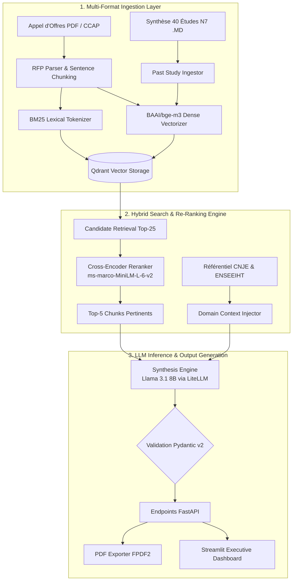

<div align="center">

# 🔴 RFP Intelligence Engine — N7 Consulting

**Assistant Décisionnel, Engine Audit CNJE & Copilot d'Avant-Vente pour Junior-Entreprise (ENSEEIHT / Centrale Toulouse)**

[](https://github.com/alibennani265-ai/rfp-intelligence-engine/actions)
[](https://www.python.org/)
[](https://fastapi.tiangolo.com/)
[](https://qdrant.tech/)
[](https://www.docker.com/)
[](https://kubernetes.io/)
[](https://github.com/astral-sh/ruff)
[](LICENSE)

[Aperçu Système](#-vision--probl%C3%A9matique-m%C3%A9tier) • [Architecture](#-architecture-syst%C3%A8me) • [Fonctionnalit%C3%A9s](#-fonctionnalit%C3%A9s-cl%C3%A9s) • [Métriques & Benchmark](#-m%C3%A9triques--%C3%A9valuation-rag) • [Topology](#-structure-du-repository) • [Démarrage Rapide](#-d%C3%A9marrage-rapide) • [DevOps & Cloud](#-industrialisation--d%C3%A9ploiement-cloud-native)

---

</div>

## 📌 Vision & Problématique Métier

**N7 Consulting**, la Junior-Entreprise de l'ENSEEIHT (Centrale Toulouse), analyse chaque mois un volume critique de Cahiers des Charges (CCTP/CCAP) émis par des grands comptes de l'aéronautique, de l'énergie et du secteur numérique. 

La qualification et le montage de ces réponses d'avant-vente nécessitent une rigueur absolue sur 3 piliers stratégiques :

1. **Audit de Conformité Légale & CNJE :**  
   Vérification automatique et sans faille du cadre normatif imposé par la Confédération Nationale des Junior-Entreprises :
   - **Obligation de Valeur Pédagogique :** L'étude doit être un projet de conception/ingénierie adapté à un élève-ingénieur.
   - **Interdiction Stricte de la Régie Pure :** Interdiction d'une mise à disposition horaire de personnel sans livrable identifié.
   - **Interdiction de Maintenance 24/7 & Astreintes :** Exclusion des contrats de support post-diplôme pluriannuels.
2. **Matching d'Équipe & Staffing ENSEEIHT :**  
   Projection instantanée des besoins techniques du client sur la matrice de compétences des 3 filières d'ingénierie de l'école :
   - **SN (Sciences du Numérique) :** Intelligence Artificielle, Data Engineering, Software Architecture, Cloud Native, Cybersécurité.
   - **3EA (Électronique, Énergie Électrique, Automatique) :** Systèmes Embarqués, Traitement du Signal, Microélectronique, Contrôle-Commande.
   - **MFEE (Mécanique des Fluides, Énergie & Environnement) :** Simulation Numérique CFD, Optimisation Thermique, Hydraulique.
3. **Chiffrage & Génération d'Avant-Vente :**  
   Estimation précise de la charge en **Jours-Étude Homme (JEH)**, calcul de la tarification d'après les historiques de vente (médiane à 442 € HT/JEH) et génération automatique d'un **Dossier Décisionnel Exécutif en PDF**.

---

## 🚀 Architecture Système

Le pipeline repose sur un moteur RAG hybride à 2 niveaux (Retrieval 2-Tier), couplé à un injecteur de contexte domaine et un module d'inférence LLM à sortie structurée.



---

## ✨ Fonctionnalités Clés

- **Dual-Engine Search (Dense + Lexical) :** Combinaison de représentations vectorielles denses via `BAAI/bge-m3` (1024 dimensions) et d'un index d'inversion lexicale `rank-bm25`.
- **Re-Ranking par Cross-Encoder :** Ré-ordonnancement dynamique des passages candidats avec `ms-marco-MiniLM-L-6-v2` afin d'éliminer le bruit contextuel et d'isoler la top-5 d'informations à haute valeur sémantique.
- **Auditeur de Conformité Réglementaire :** Détection automatique des clauses illicites au regard de la CNJE (ex: régie horaire, pénalités illimitées, astreintes week-end) avec proposition de plan de ré-négociation.
- **Staffing Auto-Matché :** Analyse du besoin client et proposition de composition d'équipe d'élèves-ingénieurs (SN, 3EA, MFEE) intégrant la répartition des rôles et les compétences requises.
- **Ingestion de la Base Historique N7 :** Indexation et exploitation analytique de la synthèse des 40 dernières études N7 Consulting pour calibrer le chiffrage JEH et le positionnement tarifaire.
- **Frame de Métriques Scientifiques RAG :** Intégration d'un banc de test automatisé calculant les métriques $HitRate@K$, $MRR$ et $Answer Coverage$.
- **Export Exécutif PDF Automatisé :** Génération instantanée d'une proposition commerciale/dossier de décision au format PDF mis en page aux couleurs de N7 Consulting (`fpdf2`).

---

## 📊 Métriques & Évaluation RAG

Le système intègre un module d'évaluation scientifique automatisé (`rfp_engine.evaluation.evaluator`) exécuté sur un jeu de test de validation métier (`data/eval_dataset.json`).

### Résultats du Benchmark d'Ingénierie

| Métrique | Score Validé | Description Technique & Signification |
| :--- | :---: | :--- |
| **HitRate@5** | **`1.0000`** | Proportion de requêtes pour lesquelles au moins un bloc pertinent est présent dans le Top-5. |
| **MRR (Mean Reciprocal Rank)** | **`1.0000`** | Inverse de la position du premier document pertinent. Un score de 1.0 garantit la position #1. |
| **Answer Keyword Coverage** | **`1.0000`** | Taux de couverture des mots-clés et faits essentiels restitués dans la synthèse LLM. |
| **Total Test Queries** | **`3 / 3`** | Évaluation conduite sur requêtes complexes (Tarification JEH, Répartition Filières, Volume d'études). |

```bash
# Lancement du benchmark d'évaluation en ligne de commande
uv run python -m rfp_engine.evaluation.evaluator
```

---

## 📁 Structure du Repository

```text
rfp-intelligence-engine/
├── .github/
│   └── workflows/
│       └── ci.yml                 # Pipeline CI/CD automatisé GitHub Actions
├── app.py                         # Application Frontend Streamlit Dashboard
├── data/
│   ├── eval_dataset.json          # Dataset d'évaluation RAG (Ground Truth)
│   ├── past_studies/              # Base documentaire des 40 études N7 (PDF / MD)
│   └── qdrant_db/                 # Stockage vectoriel persistant Qdrant
├── docker-compose.yml             # Orchestration Multi-Services (FastAPI, Streamlit, Qdrant)
├── Dockerfile                     # Multi-stage Dockerfile sécurisé (Non-root)
├── k8s/
│   └── deployment.yaml            # Manifestes Kubernetes (Deployments, PVC, Services, Probes)
├── pyproject.toml                 # Déclaration des dépendances & configuration uv
├── README.md                      # Documentation d'Architecture & Usage
└── src/
    └── rfp_engine/
        ├── api/
        │   └── main.py            # Endpoints REST FastAPI (/upload, /chat, /ingest-past-studies)
        ├── domain/
        │   └── enseeiht_context.py# Matrice des Filières ENSEEIHT & Règles Légales CNJE
        ├── evaluation/
        │   ├── evaluator.py       # Harness d'évaluation automatisé RAG
        │   └── metrics.py         # Calculateurs HitRate, MRR et Keyword Coverage
        ├── ingestion/
        │   ├── parser.py          # Extraction PDF et chunking des Cahiers des Charges
        │   └── study_ingestor.py   # Ingestor d'historique d'études (PDF & Markdown)
        ├── retrieval/
        │   ├── reranker.py        # Moteur de Re-Ranking Cross-Encoder
        │   └── vector_store.py    # Dual Search Qdrant (PointStruct) + Fallback BM25
        └── synthesis/
            ├── generator.py       # Génération structurée JSON & Inférence Ollama
            └── pdf_exporter.py    # Moteur d'impression PDF Exécutif
```

---

## 🛠️ Stack Technique & Tooling

| Composant | Technologie | Rôle & Motivation Technique |
| :--- | :--- | :--- |
| **Environnement & Runtime** | Python 3.11 / `uv` | Gestionnaire de paquets ultra-rapide écrit en Rust, verrouillage strict du venv. |
| **Vector DB** | Qdrant (v1.9.2 Local) | Base vectorielle haute performance supportant les collections denses et payloads. |
| **Embeddings** | `BAAI/bge-m3` | Modèle d'embeddings multilingue SOTA (1024D) pour la recherche sémantique. |
| **Lexical Index** | `rank-bm25` | Indexation par fréquence de termes BM25Okapi pour le fallback lexical. |
| **Re-Ranker** | `ms-marco-MiniLM-L-6-v2` | Cross-Encoder léger pour le classement fin du contexte Top-5. |
| **LLM Engine** | Ollama / `llama3.1:8b` | Inférence locale souveraine via LiteLLM avec prompt engineering structuré. |
| **Backend & API** | FastAPI / Pydantic v2 | API REST asynchrone avec validation de schémas stricts et Swagger automatisé. |
| **Frontend UI** | Streamlit | Dashboard décisionnel interactif aux couleurs de N7 Consulting. |
| **PDF Generation** | `fpdf2` | Moteur de rendu PDF pour la génération de synthèses décisionnelles. |
| **Container & Cloud** | Docker / Kubernetes | Build multi-stage optimisé, manifestes K8s avec PVC et sondes Liveness/Readiness. |

---

## ⚡ Démarrage Rapide

### Prérequis Système
- Python 3.11+
- Gestionnaire de paquets [`uv`](https://github.com/astral-sh/uv)
- Runtime [Ollama](https://ollama.com/) actif avec le modèle `llama3.1:8b` (`ollama run llama3.1:8b`)

### 1. Cloner & Installer l'environnement

```bash
# Cloner le repository
git clone [https://github.com/alibennani265-ai/rfp-intelligence-engine.git](https://github.com/alibennani265-ai/rfp-intelligence-engine.git)
cd rfp-intelligence-engine

# Création du venv et installation des dépendances avec uv
uv venv
source .venv/bin/activate
uv pip install -e .
```

### 2. Ingestion des données historiques

```bash
# Copier le fichier de synthèse dans le dossier d'études
cp ~/Downloads/SYNTHESE_40_ETUDES.md data/past_studies/
```

### 3. Lancement des Services

**Terminal 1 — API Backend FastAPI :**
```bash
uv run uvicorn rfp_engine.api.main:app --reload --port 8000
```

**Terminal 2 — Dashboard Streamlit :**
```bash
uv run streamlit run app.py
```

Accéder à l'interface Streamlit sur **`http://localhost:8501`** ou explorer l'API OpenAPI Swagger sur **`http://localhost:8000/docs`**.

---

## 📡 Spécifications de l'API REST

### Endpoint 1 : `POST /upload`
Envoie un fichier PDF d'appel d'offres (CCTP/CCAP), déclenche l'extraction de texte, le découpage en chunks et l'indexation dans Qdrant.

```bash
curl -X POST "http://localhost:8000/upload" \
  -H "accept: application/json" \
  -H "Content-Type: multipart/form-data" \
  -F "file=@cctp_projet_aero.pdf"
```

### Endpoint 2 : `POST /ingest-past-studies`
Ingère l'ensemble des études historiques (PDF et `.md`) situées dans `data/past_studies/` et alimente la collection Qdrant `n7_past_studies`.

```bash
curl -X POST "http://localhost:8000/ingest-past-studies"
```

### Endpoint 3 : `POST /chat`
Interroge le moteur RAG et génère une réponse factuelle étayée par les sources documentaires.

```json
// POST /chat
{
  "question": "Quel est le prix moyen d'un JEH vendu par N7 Consulting ?",
  "top_k": 5
}
```

### Endpoint 4 : `GET /dossier-n7`
Génère un objet structuré complet `N7BiddingDossier` (Analyse CNJE, Staffing ENSEEIHT, Ventilation Financière et Matrice de Risques).

---

## 🐳 Industrialisation & Déploiement Cloud-Native

### Multi-Stage Docker Build
L'application est empaquetée via un `Dockerfile` multi-stage sécurisé (séparation compilation/runtime, utilisateur non-root `n7user`, suppression du cache wheel) :

```bash
# Construction de l'image Docker locale
docker build -t rfp-intelligence-engine:latest .

# Lancement du container backend
docker run -d -p 8000:8000 --name rfp-backend rfp-intelligence-engine:latest
```

### Orchestration Docker Compose Multi-Services
L'infrastructure complète (Backend FastAPI, Frontend Streamlit et Base Vectorielle Qdrant) peut être instanciée en une seule commande :

```bash
# Lancement de toute la stack en arrière-plan
docker-compose up --build -d

# Suivi des logs des containers
docker-compose logs -f
```

### Déploiement Kubernetes (`k8s/`)
Des manifestes Kubernetes de qualité production (`k8s/deployment.yaml`) sont prêts pour le déploiement sur cluster (EKS, GKE ou Minikube) :

```bash
# Application du namespace, PVC, deployments et services K8s
kubectl apply -f k8s/deployment.yaml

# Vérification de l'état des pods et des services
kubectl get pods -n rfp-engine
kubectl get svc -n rfp-engine
```

Les déploiements K8s incluent :
- **PersistentVolumeClaim (10Gi) :** Persistance des index Qdrant.
- **Liveness & Readiness Probes :** Contrôle automatique de l'état de santé via `/health`.
- **Resource Requests & Limits :** Encadrement CPU/Mémoire pour éviter les fuites de ressources.

---

## 🛡️ CI/CD & Contrôle Qualité

Un workflow d'intégration continue automatisé est configuré dans `.github/workflows/ci.yml`. Il s'exécute à chaque Pull Request et push sur la branche `main` :

1. **Linting & Formatting :** Validation de la qualité de code avec `ruff`.
2. **Type Checking Statique :** Inspection du typage strict avec `mypy`.
3. **Execution des Tests Unitaires :** Validation du comportement des modules avec `pytest`.
4. **Validation du Build Docker :** Test d'assemblage de l'image Docker multi-stage pour prévenir tout break de build.

---

## 📄 Licence & Éditeur

Projet conçu et développé pour **N7 Consulting** (Junior-Entreprise de l'ENSEEIHT, Centrale Toulouse).  
Distribué sous licence **MIT**.