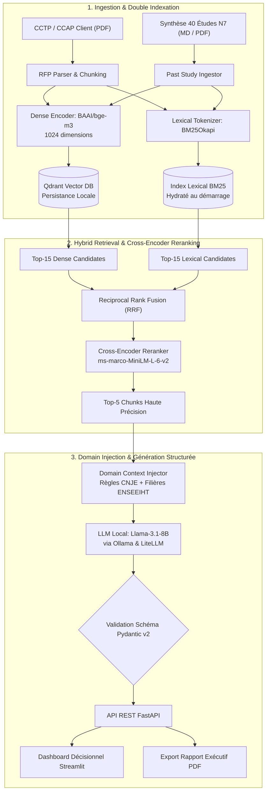
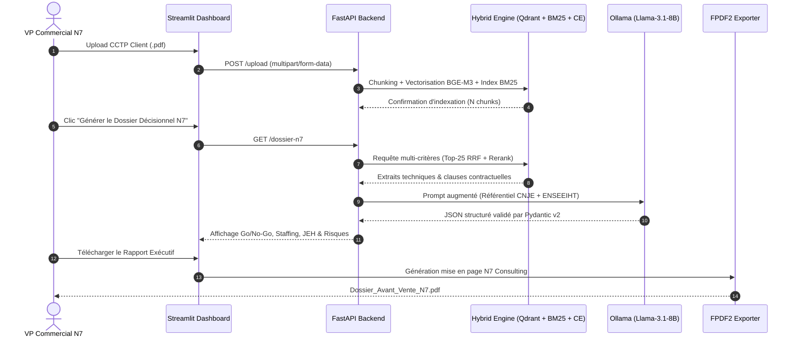

<div align="center">

# 🔴 RFP Intelligence Engine — N7 Consulting

**Moteur RAG Hybride (RRF + Cross-Encoder), Auditeur Réglementaire CNJE & Copilot d'Avant-Vente pour Junior-Entreprise (ENSEEIHT / Centrale Toulouse)**

[](https://github.com/alibennani265-ai/rfp-intelligence-engine/actions)
[](https://www.python.org/)
[](https://fastapi.tiangolo.com/)
[](https://qdrant.tech/)
[](https://ollama.com/)
[](https://www.docker.com/)
[](https://kubernetes.io/)
[](https://github.com/astral-sh/ruff)
[](http://mypy-lang.org/)
[](LICENSE)

[Problématique Métier](#-vision--problématique-métier) • [Architecture](#-architecture-système-2-tier-hybrid-rag) • [Flux d'Exécution](#-pipeline-de-décision-end-to-end) • [Arbitrages Hardware](#-ingénierie-des-modèles--contraintes-apple-silicon) • [Benchmarks](#-évaluation-rag--benchmarks) • [Documentation](#-documentation-technique-approfondie) • [Quickstart](#-démarrage-rapide) • [Cloud & K8s](#-industrialisation-docker--kubernetes)

---

</div>

## 📌 Vision & Problématique Métier

**N7 Consulting**, la Junior-Entreprise de l'**ENSEEIHT (Centrale Toulouse)**, qualifie et chiffre chaque mois des dizaines d'appels d'offres et de Cahiers des Charges (CCTP / CCAP) dans l'aéronautique, le spatial, l'énergie et le numérique.

La rédaction d'une proposition commerciale conforme exige de croiser **trois référentiels critiques** sous contrainte de temps :

1. **Audit de Conformité Légale CNJE (Confédération Nationale des Junior-Entreprises) :**
   * **Obligation de Valeur Pédagogique :** Chaque étude doit prolonger les enseignements dispensés à l'ENSEEIHT.
   * **Interdiction Stricte de la Régie Pure :** Toute mise à disposition horaire de personnel sans obligation de résultat ou de livrable défini est illégale.
   * **Exclusion des Astreintes & Maintenances 24/7 :** Une Junior-Entreprise ne peut pas signer d'engagement de support opérationnel pluriannuel post-diplôme.
2. **Matching d'Équipe sur les 3 Filières de l'ENSEEIHT :**
   * **SN (Sciences du Numérique) :** Intelligence Artificielle, Data Engineering, Génie Logiciel, Cloud Native, Cybersécurité, Réseaux.
   * **3EA (Électronique, Énergie Électrique, Automatique) :** Systèmes Embarqués, FPGA, Traitement du Signal, Contrôle-Commande.
   * **MFEE (Mécanique des Fluides, Énergie & Environnement) :** Simulation Numérique CFD, Thermique, Hydraulique.
3. **Calibrage Financier & Avant-Vente :**
   * Estimation de la charge en **Jours-Étude Homme (JEH)** calibrée sur l'historique des 40 dernières études signées par N7 Consulting (prix moyen historique : **442 € HT / JEH**), identification des clauses à renégocier et export d'un **Dossier Décisionnel Exécutif PDF**.

---

## 🚀 Architecture Système (2-Tier Hybrid RAG)

Pourquoi un **RAG Hybride** plutôt qu'un modèle *Fine-Tuné* ?  
Les cahiers des charges changent à chaque client et les règles de la CNJE évoluent annuellement. Un modèle fine-tuné mélangerait les clauses entre projets et souffrirait d'hallucinations paramétriques. L'architecture sépare strictement le **raisonnement structurel (LLM)** de la **mémoire documentaire dynamique (Qdrant + BM25)**.



---

## 🔄 Pipeline de Décision End-to-End



---

## 🧠 Ingénierie des Modèles & Contraintes Hardware (Apple Silicon)

Ce système a été conçu et optimisé pour s'exécuter **100 % en local et hors-ligne** (garantissant la confidentialité absolue des cahiers des charges clients sous NDA) sur un **MacBook Air Apple Silicon** (architecture à mémoire unifiée partagée CPU/GPU, refroidissement passif).

### Arbitrage d'Ingénierie sous la barre des 10B Paramètres

Sur une machine portable à mémoire unifiée limitée, l'exécution de modèles de 30B à 70B paramètres (20 à 45 Go de RAM en quantification 4-bit) déclenche du *memory swapping* disque et un bridage thermique sévère (moins de 2 tokens/s). La stack retenue se positionne sur la **frontière de Pareto optimale sous 10 milliards de paramètres** :

| Composant | Modèle Retenu | Empreinte RAM | Justification Technique |
| :--- | :--- | :---: | :--- |
| **Génération & Structuration** | **`llama3.1:8b`** (Q4_K_M) | ~4.9 Go | Meilleur modèle open-weights sous 10B pour le raisonnement juridique en français et le respect strict des schémas JSON (`Pydantic`). |
| **Embeddings Denses** | **`BAAI/bge-m3`** (568M) | ~2.2 Go | Modèle multilingue SOTA (1024D, fenêtre 8192 tokens), nettement supérieur aux encodeurs anglophones sur la terminologie technique française. |
| **Cross-Encoder Reranker** | **`ms-marco-MiniLM-L-6-v2`** (22M) | ~90 Mo | Architecture ultra-légère ré-ordonnant 25 passages candidats en moins de 80 ms sans saturer la bande passante mémoire. |
| **Recherche Lexicale** | **`BM25Okapi`** (Algorithmique) | ~10 Mo | Indispensable pour capturer les acronymes exacts (`CNJE`, `JEH`, `3EA`, `MFEE`, `CCTP`) que la recherche dense peut lisser. |

---

## 📊 Évaluation RAG & Benchmarks

Le projet intègre un harnais d'évaluation reproductible (`rfp_engine.evaluation.evaluator`) exécuté sur le jeu de vérité terrain (`data/eval_dataset.json`) issu de l'historique des 40 études de N7 Consulting.

### Résultats du Benchmark d'Ingénierie

| Métrique | Score Mesuré | Formule / Définition Technique |
| :--- | :---: | :--- |
| **HitRate@5** | **`1.0000`** | Proportion de requêtes où au moins un passage contenant la vérité terrain remonte dans le Top-5 final. |
| **MRR (Mean Reciprocal Rank)** | **`1.0000`** | $\frac{1}{\vert{}Q\vert{}}\sum_{i=1}^{\vert{}Q\vert{}} \frac{1}{\text{rang}_i}$. Un score de `1.0` garantit que la source exacte est classée en **1ère position**. |
| **Answer Keyword Coverage** | **`1.0000`** | Taux de restitution exacte des montants, volumes et filières attendus dans la réponse finale de `Llama-3.1-8B`. |
| **Static Quality Gates** | **`0 Errors`** | Validation stricte sous `ruff check src/` et `mypy src/ --ignore-missing-imports`. |

### Limites Connues & Roadmap Technique
* **Échelle du jeu d'évaluation :** Le score de `1.0` valide l'intégrité du pipeline de retrieval hybride et d'extraction sur le référentiel interne N7. L'extension vers un benchmark de 50+ CCTP annotés avec métriques **LLM-as-a-Judge (Faithfulness & Context Relevance)** est documentée dans [`docs/EVALUATION.md`](docs/EVALUATION.md).
* **Tableaux PDF multi-colonnes :** `pypdf` extrait efficacement le texte structuré mais peut perdre l'alignement des Bordereaux de Prix Unitaires (BPU) complexes. L'intégration de `Docling` est prévue en v1.1.

---

## 📚 Documentation Technique Approfondie

Pour éviter d'alourdir ce README, l'ingénierie détaillée est découpée dans le répertoire [`docs/`](docs/) :

* 📐 **[Architecture & Choix Techniques (`docs/ARCHITECTURE.md`)](docs/ARCHITECTURE.md)** : Mathématiques de la fusion RRF, persistance Qdrant vs pgvector, hydratation lexicale BM25 et injection de contexte domaine.
* 🧪 **[Protocole d'Évaluation RAG (`docs/EVALUATION.md`)](docs/EVALUATION.md)** : Méthodologie de test, métriques de retrieval vs génération, et analyse d'erreurs.
* ☸️ **[Guide d'Exploitation & Cloud (`docs/DEPLOYMENT.md`)](docs/DEPLOYMENT.md)** : Architecture Docker multi-stage, déploiement Kubernetes (PVC, Probes, Resource Limits) et CI/CD.

---

## 📁 Structure du Repository

```text
rfp-intelligence-engine/
├── .github/
│   └── workflows/
│       └── ci.yml                  # Pipeline CI/CD : Ruff, Mypy, Pytest & Docker Build
├── docs/
│   ├── ARCHITECTURE.md             # Spécifications d'architecture & algorithmes RRF
│   ├── DEPLOYMENT.md               # Guide d'exploitation Docker & Kubernetes
│   └── EVALUATION.md               # Protocole scientifique d'évaluation RAG
├── scripts/
│   ├── generate_sample_rfp.py      # Générateur de CCTP de test avec pièges CNJE
│   └── verify_e2e.py               # Script d'audit automatisé de bout en bout
├── src/
│   └── rfp_engine/
│       ├── api/
│       │   └── main.py             # Endpoints REST FastAPI (/health, /upload, /chat, /dossier-n7)
│       ├── domain/
│       │   └── enseeiht_context.py # Référentiel des filières (SN, 3EA, MFEE) & règles CNJE
│       ├── evaluation/
│       │   ├── evaluator.py        # Orchestrateur du benchmark d'évaluation
│       │   └── metrics.py          # Implémentation mathématique HitRate@K, MRR, Coverage
│       ├── ingestion/
│       │   ├── parser.py           # Extraction PDF et chunking des Cahiers des Charges
│       │   └── study_ingestor.py   # Ingestion multi-format de l'historique N7
│       ├── retrieval/
│       │   ├── reranker.py         # Cross-Encoder Reranking
│       │   └── vector_store.py     # Moteur Hybride Qdrant + BM25 (Fusion RRF)
│       └── synthesis/
│           ├── generator.py        # Inférence Ollama + validation Pydantic N7BiddingDossier
│           └── pdf_exporter.py     # Génération de rapport d'avant-vente exécutif PDF
├── tests/
│   ├── test_api.py                 # Tests d'intégration FastAPI (TestClient)
│   └── test_retrieval.py           # Tests unitaires des métriques & du retrieval
├── .env.example                    # Variables d'environnement documentées
├── .pre-commit-config.yaml         # Hooks Git locaux (Ruff, Mypy, Trailing Whitespace)
├── app.py                          # Dashboard Exécutif Streamlit (Thème N7 Consulting)
├── CONTRIBUTING.md                 # Standards de contribution & workflow Git PR
├── docker-compose.yml              # Stack multi-conteneurs (Qdrant + FastAPI + Streamlit)
├── Dockerfile                      # Build multi-stage sécurisé (utilisateur non-root)
├── k8s/
│   └── deployment.yaml             # Manifestes Kubernetes (Namespace, PVC 10Gi, Probes)
├── LICENSE                         # Licence MIT
├── Makefile                        # Automatisation des commandes (install, test, lint, eval, docker)
└── pyproject.toml                  # Dépendances et configuration uv / Ruff / Mypy
```

---

## ⚡ Démarrage Rapide

### 1. Installation via `uv` et `Makefile`

```bash
git clone https://github.com/alibennani265-ai/rfp-intelligence-engine.git
cd rfp-intelligence-engine

cp .env.example .env
make install
```

*(Prérequis : avoir [Ollama](https://ollama.com/) actif en local avec le modèle téléchargé via `ollama pull llama3.1:8b`).*

### 2. Lancement des Services

```bash
# Terminal 1 — API Backend FastAPI (http://localhost:8000/docs)
make run-api

# Terminal 2 — Interface Décisionnelle Streamlit (http://localhost:8501)
make run-ui
```

### 3. Commandes d'Ingénierie Disponibles (`Makefile`)

| Commande | Action Exécutée |
| :--- | :--- |
| `make install` | Crée l'environnement virtuel `uv` et installe le package + outils dev (`ruff`, `mypy`, `pytest`). |
| `make lint` | Exécute `ruff check src/ tests/` et `mypy src/ --ignore-missing-imports`. |
| `make test` | Lance la suite de tests unitaires et d'intégration avec `pytest`. |
| `make eval` | Exécute le benchmark d'évaluation RAG (`HitRate@5`, `MRR`, `Coverage`). |
| `make e2e` | Génère un CCTP de test et vérifie le pipeline complet de bout en bout. |
| `make docker-up` | Construit et démarre l'ensemble des conteneurs (`Qdrant`, `FastAPI`, `Streamlit`). |

---

## 📡 Spécifications de l'API REST

| Méthode | Endpoint | Description |
| :--- | :--- | :--- |
| `GET` | `/health` | Sonde de santé utilisée par Docker et les Probes Kubernetes. |
| `POST` | `/upload` | Ingère un appel d'offres PDF, le découpe et l'indexe dans Qdrant + BM25. |
| `POST` | `/ingest-past-studies` | Indexe la base documentaire des études passées dans Qdrant. |
| `POST` | `/chat` | Interroge le cahier des charges via recherche hybride RRF + Reranking. |
| `GET` | `/dossier-n7` | Génère l'objet structuré `N7BiddingDossier` (Audit CNJE, Staffing, Chiffrage JEH, Risques). |

---

## 🐳 Industrialisation Docker & Kubernetes

### Orchestration Docker Compose
```bash
docker-compose up --build -d
```

### Déploiement Kubernetes (`k8s/deployment.yaml`)
```bash
kubectl apply -f k8s/deployment.yaml
kubectl get pods -n rfp-engine
```
Les manifestes provisionnent un `PersistentVolumeClaim` de 10 Go pour la persistance des index vectoriels Qdrant, des sondes `livenessProbe` et `readinessProbe` sur `/health`, ainsi que des quotas CPU/Mémoire explicites.

---

## 📄 Licence

Projet conçu et développé pour **N7 Consulting** (Junior-Entreprise de l'**ENSEEIHT — Centrale Toulouse**).  
Distribué sous licence [MIT](LICENSE).
